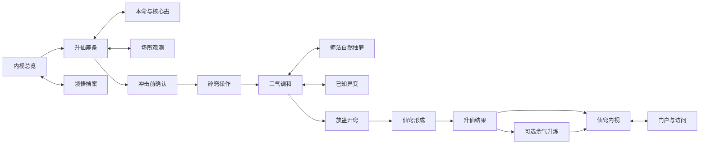

# 升仙全界面 UI 设计计划

日期：2026-10-26。项目：`D:/daima/mcmod/升仙`。此文件记录完整 UI 蓝图；0.2.4 已落地升仙卷与三气调和两个页面，其余界面仍按下文分批实现。

用户已选定视觉方向：**水墨卷册＋三气气流**。

目标：从准备升仙到成仙后的内视、进出仙窍，以及失败、重连和多人护道，提供一套连续、可操作、能看清世界的界面。界面只呈现实际状态，不用美术表现代替缺失机制；原著步骤与游戏中的操作表达分别标明。

## 1. 当前界面基线

本节记录当前代码状态，后续 S01–S16 仍是完整 UI 蓝图：

- 0.2.4 已有 K 键入口和“升仙卷 / 三气调和”两页，使用中文水墨纸色面板。
- 打开界面时客户端请求仅属于自己的快照；服务端回传阶段、三气、人气储备、最大风险、交感窗、灾劫与仙窍结果。动作按钮收到服务器结果后也刷新快照；客户端数值不参与条件判断。
- 三气页显示服务端数值与窗口/灾劫，界面关闭不会暂停；“停止抽纳”清除主动意图，服务器仍以零抽纳推进时间。
- 服务端动作结果目前通过系统消息和快照回传；没有完整收件箱、独立灾劫图册、访问/护道管理面板、内视、仙窍管理和日志页。
- 当前源码仅完成 Java 编译与 JAR 结构核验，没有真人鼠标/键盘完整升仙实测；历史截图不能替代本版本验收。
- 本命蛊通过 fingerprint 和本体镜像/背包核对，但没有移入真实托管容器或炼成唯一仙蛊；特殊升仙路线仍关闭。

本计划沿现有 `client/`、`network/`、`server/`、`core/` 分包扩展，不重建工程。宿命蛊的世界系统不在本轮 UI 范围；若将来影响某条升仙路线，只在筹备页显示已核实、玩家有资格知道的结果。

## 2. 视觉与布局原则

### 2.1 视觉语言

静态阅读页使用淡宣纸与墨线，边缘表现卷册装订；进行中的操作页使用半透明墨底，将中央世界视野留出来。三气沿不同方向流动，在空窍投影处交汇，成为全套界面的主要识别元素。

建议色板均属 UI 选择，不是原著定量：

- 纸底：石灰白 `#E5E1D5`。
- 深墨：`#172321`；正文：`#29342F`。
- 天气：清青 `#76A8C5`，同时配“天”字与向下纹样。
- 地气：赭金 `#B79B61`，同时配“地”字与向上纹样。
- 人气：银白 `#DADDD2`，同时配“人”字与向内纹样。
- 可操作与焦点：青玉 `#7FAF9A`。
- 危险：朱砂 `#B65D4B`，同时配形状、文字和可关闭的声音。

不用颜色单独区分气种、危险或按钮状态。正文保持清晰，纸纹不能影响中文笔画。活动页上亮色文字有足够的不透明衬底，实际世界背景明暗改变时也能读清。

使用 Minecraft 可用的清晰中文字体作正文，保持原生字形的整数比例。书法感只用于少量标题和图形，不能把正文做成图片。布局随可用空间变化，禁止将整张面板缩小再拉大造成模糊。

### 2.2 三种尺寸

尺寸以下按 Minecraft 缩放后的 GUI 坐标判断，不直接按显示器分辨率判断：

- 宽屏：可用空间至少 640×360，使用导航、主区、详情三部分。
- 标准：至少 480×270，保留主区和紧凑导航，详情使用抽屉。
- 紧凑：至少 320×180，单列与分页，只在正文区滚动；主要操作始终可见。
- 更小空间：显示可读的紧凑模式提示，允许关闭并保留 HUD；不能让不可逆按钮跑出屏幕。

按钮通常高 20–24 GUI 单位，正文行距 12–14。具体美术尺寸在原型中校验；不能为了塞满文字不断减小字号。危险按钮与关闭按钮分开，留出不会误点的间距。

### 2.3 信息层级

第一层只回答：我处于哪一步、当前最重要的变化、现在能做什么。

第二层回答：三气趋势、本命蛊、已知灾劫、领悟窗口及动作结果。

第三层保存：细节、已知条件、记录与说明，按需展开。

玩家界面不显示 CAS、schema、revision、后台评分、准确成功率、未经观察的灾劫答案或他人仙窍隐私。原始数值诊断保留在管理员工具，与正式玩家 UI 分离。

## 3. 全部界面与显示层

编号用于设计追踪，不代表原著有十六个独立阶段。实现上复用同一宿主与组件，不给每一步都叠一个全屏弹窗。

### S01 内视总览

入口：K 键；非升仙中默认打开。已有活动会话时，K 回到当前操作页。

内容：当前空窍/仙窍、修为、已知人气积累描述、本命蛊、当前经历与最近变化。第一/第二空窍由服务端确认存在后才可切换。

操作：查看筹备、本命蛊、领悟档案、仙窍及设置。未开仙窍时不给出虚构的仙元和面积。

收到并接受护道请求后，总览增加“协作”页签，列出本人有权查看的现场对象；从这里进入 D02。K 不自动打开他人的私密内视，不因靠近别人就获得其完整会话。

空状态：未开窍显示对应原因；无活动升仙不显示假的进度条。不同空窍的选择与记录不能混用。

### S02 升仙筹备

内容分为个人条件、本命与核心蛊、当前场所、支持手段四组。每项显示“满足 / 尚缺 / 未知 / 此法尚未开放”。未知不能涂成绿色。

只展示玩家已经掌握或当前系统确实能核验的条件。环境未调查时显示“天地二气尚未辨明”，不能自动给出全图最优升仙点。

主操作：“检查当前条件”；具备完整路线能力后才出现可用的“冲击窍壁”。没有完整后端时明确显示“此升仙法尚未开放，不能开始”。

支持手段中提供“护道协作”，打开 D03；这属于模组协作便利功能，不冒充原著契约，也不强制升仙前必须组队。

不会显示百分比成功率。准备页的满足项不是成仙保票。

### S03 本命与核心蛊

布局：真实本命蛊位置、候选核心蛊列表、当前背包及说明区。使用真实物品图标和名称。

显示蛊虫所属空窍、当前所在位置、绑定或暂存状态。已经由其他过程占用的物品不可重复选择。

“加入核心候选”只代表准备选择，不能提前扣物或制造托管副本。改变本命蛊不是本计划新增的免费功能；只有本体已有且核定的操作才显示。

### S04 场所观测

内容：当前位置已观察到的天气、地气变化、可见危险与本人调查记录。以气流浓淡和文字等级表现感知，精确数字按实际知识能力开放。

操作：查看附近已知现象、更新本人观测、返回筹备。不得新增自动传送到“最佳升仙点”的按钮。

未加载或未观察区域不展示实时库存、玩家、灾劫与安全结论。它是辅助判断的界面，不是升仙必做小游戏。

### S05 碎窍操作

左侧：窍壁投影与真实裂纹演化；右侧：冲击控制和当前真元；中央保留世界视野。

发起冲击前使用 M01 风险确认。冲击期间显示“冲击窍壁 / 窍壁裂变 / 已彻底碎裂”等已确认状态。

在规则允许且尚未完全碎裂时提供“停止冲击”，说明剩余伤势按实际记录保留。彻底碎窍后该操作消失，不出现恢复空窍或取消升仙按钮。

不能把视觉裂纹百分比当服务器已碎窍证据；只有服务器确认后才进入下一状态。

### S06 三气调和主界面

这是全套最核心的操作页，优先制作。

- 天气从上向下、地气从下向上、人气从角色投影向内汇聚。
- 每种气显示当前趋势、玩家可感知的状态和调控位置；控制意图与实际吸入量分开表现。
- 提供三个可键盘调整的调控杆，取代要求玩家手动输入 0.5 的默认流程。
- 左右方向键调节当前选中项，Tab 切换焦点；具体快捷键可改绑，并复用页面实际显示的绑定提示。
- 人气同时显示有限储备的可感知描述，不能表现成无限可生产的资源。
- 稳定区、趋势箭头和偏盛告警表达“正在趋稳 / 正在偏离”，不把三条 UI 柱子的几何等长宣传为原著数学定律。
- D01 师法自然从侧面展开，主区与世界反馈继续更新。

主要操作：“调控”“体悟”“查看已知异变”“收起界面”。次级“护道协作”在同一宿主内打开 D03。不设“一键平衡”或“保证成功”。

如规则具有收束吸纳动作，其按钮必须明确说明作用于气流而不是取消升仙，并由服务器判定是否可行。原型的 `stop` 不能直接复用为该动作。

草图中的区域关系：

```text
┌ 当前空窍 · 纳气 ─────────────── 状态与回执 ┐
│ 天气趋势        世界视野 / 三气交汇       体悟抽屉 │
│ 地气趋势        空窍投影与危险方向         按需展开 │
│ 人气余量        可切换为清晰的柱状视图             │
├ 天气调控 ───── 地气调控 ───── 人气调控 ┤
│ 关键告警     [体悟] [已知异变] [收起界面]         │
└─────────────────────────────────┘
```

### S07 已知灾劫与现场异变

以现场观察为来源，显示已发现载体、方向、当前作用与已知应对线索。未识别时用“异变未明”，不能提前列出灾劫完整答案。

操作：标记本人已知目标、切换观察信息、返回调气。该页可压缩为 H01 的告警区，不能靠遮满屏幕妨碍应劫。

击破目标后先显示“正在确认变化”，实际状态由服务器同步。区块卸载或目标暂不可见不能显示“已渡过”。

### S08 放蛊开窍

中央为当前气团与投放区，侧栏为已经核实的本命蛊和核心蛊。只从服务器给出的合法来源选择。

采用“选择 → 显示将要投入的真实蛊虫 → 点击投入 → 等待确认”，也可用键盘完成。拖动仅为可选方式，不强制依赖拖拽。

投入后显示物品处于气团、形成过程或其他已核状态；不得同时在原槽显示另一个可操作正品。背包不足、绑定变化、动作过期都保留原物并说明原因。

界面文字用“投入本命蛊 / 开辟仙窍”，不提前显示“仙蛊炼成”。条件不成立时不能靠点亮动画跳过。

### S09 仙窍形成

展示新天地形成、已纳二气、当前稳定趋势与核心蛊所在位置。世界异象仍可见。

只有服务器确实定义了可测量的形成进度，才显示进度条；否则显示“初开 / 扩展 / 渐定”等实际阶段。面积和档次尚未确定时显示“仍在形成”。

合法核心蛊操作与风险说明位于边栏。不能用固定三秒动画结束后直接颁发六转。

### S10 升仙结果

由服务器已经提交的结果打开，采用紧凑卷页，可收起而不丢记录。

内容：仙窍主修、实际福地档次与面积、内部时间关系、初生青提仙元、生命状态和本命蛊去向。寿元保持实际状态，不添加“成仙加寿”庆祝文案。

若余气升炼机会成立，在明显位置给出“借余气升炼”和“不再升炼”两个有条件操作，并展示该机会是否仍在流逝。不得因结果页还开着而冻结余气窗口。

常规操作：查看仙窍、查看本次记录、收起。升仙成功与仙蛊炼成使用不同标题和图标。

### S11 余气升炼

内容：实际余气、可用蛊虫、本人已知蛊方/残方、预计要投入的资源和已知风险。未掌握的配方不在菜单中凭空出现。

开始采用 M02 高风险动作确认；炼制期间显示真实状态和内部灾劫反馈。不能显示保证成功或虚构的精确掉率。

炼制失败单独报告材料、本命蛊和仙窍的真实结果；不能统一弹出“升仙失败”。已成仙者没有取得仙蛊也能正常使用仙窍界面。

### S12 仙窍内视总览

内容：本人仙窍的主修、面积、青提仙元、内部时间、门户状态和本人已知环境。中央为有依据的仙窍示意，细节按观察程度开放。

操作：进入仙窍、查看门户、查看收支和本次升仙记录。当前 16×16 地块是空间原型，不得画成已经实现数百万亩完整生态。

未来长期资源经营可以在此扩展，不在本轮造出未实现的商城、自动收货或生产系统。

### S13 门户与护道访问

主人视图：本人门户状态、实际返回地点、访客申请与当前授权；访客视图只显示自己有权知道的入口与请求结果。

操作：请求进入、接受/拒绝、撤回后续访问资格、离开并返回。每次实际进入由服务器重新校验，不能凭客户端的旧授权穿过门户。

撤权后如何处理已经进入的人，由世界规则先确定；首版不擅自瞬移或处死访客。原型当前只支持主人进入，访客操作在后端完成前保持未开放。

### S14 领悟档案与升仙记录

使用可翻阅卷册，保存本人真正获得的知识、蛊方完整程度、原著机制提示与本次经历。

支持按流派与时间查看、搜索和收藏。升仙中查看只能用轻量抽屉，不能进入会暂停过程的大型阅读页；完整卷册主要用于非紧急状态。

记录区分“本人观察”“传承所述”“尚未辨明”。别人升仙的私密结果、服务器后台诊断及未获得知识不随日志同步。

### S15 失败、失联与恢复

不是所有异常都开全屏失败页：

- 真正死亡：接入原有死亡流程，可从死亡界面查看升仙记录；不抢占复活操作，不暗示默认重生能恢复空窍。
- 尚存但失败：显示已确认原因、实际空窍/蛊虫状态及有依据的后续选择，不提供免费“再试一次”。
- 网络状态过期：原画面标为过期，显示最后确认时刻与连接提示；不能推演成“继续稳定”。
- 区块卸载或服务器挂起：显示挂起的实际原因，不伪称已经渡劫或取消。
- 坏档/未知版本：显示“当前记录无法继续使用，请检查存档”，保留记录与管理员诊断入口，不删除重置。

重连后自动查询本人当前状态，恢复正确页面与选中空窍；不恢复未被服务器接受的投蛊、奖励或成功提示。

### S16 界面与操作设置

内容：快捷键说明、显示密度、三气气流强度、文字/柱状替代、色觉辅助、音效、减少动态效果、HUD 位置和重置布局。

设置只影响表现，不改变规则、气量、风险、时间或成功条件。活动升仙期间使用宿主内的设置抽屉，避免跳转产生暂停。

当前选中字体、缩放与布局即时预览；“恢复布局”不能清除修行记录。首次教学可重看，原著规则与游戏参数说明分开。

### D01 师法自然抽屉

出现条件：服务端确认当前存在交感窗口，并且该路线允许对应行为。

内容：本人已知的问题方向、可提出的问题、已获得结果、当前可感知的心神负担。不同范围的问题说明其范围，不假装能问出作品未定义的一切。

操作：“体悟此问”“不再深入”“收起”。求知期间三气、灾劫和世界继续变化，关键告警仍置顶。收起不等于撤销已消耗预算，也不重新生成窗口。

### D02 护道人简报

单独给现场护道人使用，不复制主人的整套内视。

内容：实际能观察到的升仙阶段、公开求助信号、已识别的外劫目标与已知危险方向。主人授权分享的资料按字段控制。

操作：回应求助、标记本人已识别载体、请求入窍。没有替主人调气、远程取蛊或查看全部蛊方的按钮。旁观者只看到公开世界异象。

入口：在 S01 的“协作”页签选择已接受的现场请求，或点击 H01 中明确的本人协作提示。界面不自动抢占战斗焦点。授权撤回、请求结束或现场条件不符时，立即撤去对应私密字段并说明变化。

### D03 护道协作管理抽屉

主人从 S02 或 S06 主动打开。默认不发布求助、不分享私密资料；附近玩家仍可观察普通世界异象。

内容：本人已发求助、现场可选协作者、已接受对象和各对象的分享范围。操作包括“发出现场求助”“邀请现场玩家”“撤回求助”“调整分享”“停止分享”。接收者明确接受后才加入协作名录；主人不能替别人确认。

默认授权只补充主人主动发出的应劫请求及公开阶段。三气精确值、本命蛊、背包、蛊方和仙窍记录不自动分享；需要新增分享类别时必须有明确字段和用户选择，不能用一个“全部允许”开关导出整个会话。

资料分享与入窍权限完全分开：成为护道人不自动获得门户访问，获准进入也不自动能读私密升仙数据。撤回资料分享立即影响后续快照，撤回门户资格按 S13 的世界规则处理。

现场范围由服务器判定，具体距离属于游戏参数；不提供搜索全服升仙者或隔空监听的入口。离线、请求结束与重连后按服务器记录重新检查，旧按钮不能恢复撤销的权限。

### H01 活动升仙 HUD

收起主界面后，保留小型阶段标记、三气偏向、最重要告警和返回提示。它不能遮挡准星、生命、饥饿、聊天或常用本体 HUD；允许移动位置。

HUD 是只读状态与明确的快捷入口，不能在鼠标未捕获时让玩家误点不可逆操作。主界面与 HUD 读取同一份已确认状态。

### M01 冲击窍壁前确认

仅在发起真实冲击时出现。显示当前空窍、本命蛊和“彻底碎窍后不可恢复原空窍”的后果。

操作：“返回筹备”“开始冲击”。后者使用一次明确的按住确认或等价的可访问交互；持续时长是 UI 参数，不称原著条件。

默认焦点不放在危险动作；Enter 不能因上个页面输入残留直接触发。服务器最终重验，确认本身不意味着条件必然成立。

### M02 余气升炼前确认

列明将投入的真实蛊虫、已知风险和会消耗的有限资源。只确认一次，不在每个模拟步反复弹窗。

运行中不出现会掩盖灾劫的模态对话。其他普通动作使用行内确认与回执；错误通过明确消息处理。

## 4. 页面流转与并发关系



箭头只表示 UI 可能切换，不允许客户端借切页推进服务器阶段。灾劫、护道、HUD 与求知在合适阶段并行显示，不是依次通关。

失败和网络异常可从对应阶段进入 S15；恢复后查询服务器实际阶段。设置可从宿主打开，不清空活动会话。

## 5. 输入、反馈与危险动作

- K 只在没有文本输入焦点且绑定被合法触发时切换升仙宿主；允许在 Minecraft 按键设置中改绑。
- Esc 收起当前抽屉，再收起主界面；不会调用取消升仙、清空三气或旧 `stop` 行为。
- 打开操作页时鼠标用于界面；收起后恢复正常世界瞄准与移动，由 HUD 继续反馈。保留世界视野不等于已经支持同时拖动控件与鼠标战斗，也不会自动代替玩家防御。
- Tab 顺序与视觉阅读顺序一致；焦点可见。箭头调整调控项；数值精调是可选辅助，不是唯一方法。
- 输入频率由服务端约束；客户端拖动时本地显示“调控意图”，服务器回执后才更新“已生效”。
- 正常操作有待确认、已接受、被拒绝、已过期四种反馈。拒绝要给玩家可理解的原因，不仅写日志。
- 收起时未提交的编辑仅保留为本地草稿；世界使用最后一次已接受的意图，并继续按规则演化。动作超时先查询原序号结果，不以新序号盲目重发不可逆操作。
- 服务端拒绝发起时不播放成功碎窍动画；拒绝放蛊时不消失物品图标；结果页只跟随已提交的真实结果。
- 连点、按住、重开界面和重复网络包不能重复投入蛊虫、消耗资源或领取知识。
- 空间变化、被攻击或新危险不强制频繁抢焦点；用 HUD、声音和短消息提醒，避免玩家失去世界控制。

活动升仙的所有自定义 Screen 与抽屉必须明确采用不暂停策略，不能依赖原型继承的默认行为。单人 Esc 原版菜单及失焦暂停属于额外需要验证的引擎行为，未验证前不能承诺任何情况下都持续运行；正式验收必须覆盖并记录边界。

## 6. 数据与现有代码需要补齐的契约

以下是拟新增的界面数据，不代表当前载荷已具备。

### 6.1 状态快照

服务端按本人/护道人/旁观者分别投影可见内容，包含：

- 本人可见的会话标识、选中空窍、阶段、是否已碎窍与当前可用动作。
- 三气实际状态、已接受的控制意图、趋势与允许显示的储备信息。
- 交感窗口、本人知识条目及本次实际授予结果。
- 本人有权观察的灾劫与载体信息。
- 托管蛊虫、仙窍形成与结算结果的可见状态。
- 状态时刻和新旧顺序标识，客户端用于拒绝倒退快照；这些内部标识不在玩家 UI 展示。

快照字段数量、字符串和条目上限需在实现计划中固定，不能一次发送整个世界账本。客户端不从聊天文本或截图推断实际状态。

### 6.2 动作与回执

动作包含本人会话、空窍上下文、序号、预期状态及有限参数。服务器重验身份、距离、阶段、真实物品与能力。

回执至少能说明接受/拒绝、原因和对应动作；重复动作返回原处理结果或明确拒绝，不重复执行。断线后按服务器记录恢复，不能凭旧按钮动画补做。

模拟每刻改变的状态修订号与阶段上下文分开使用。调控意图不能仅因正常气机推进就持续被判过期；服务器根据有效会话、动作序号和实际阶段接收，再对内部保存做并发检查。不可逆阶段动作另行校验最新条件，不能由客户端强制覆盖状态。

### 6.3 三个必须先解决的现有问题

1. `QiIntentPayload` 只有调控值、seek 与 stop，没有完整快照和回执。正式交互必须补服务端→客户端状态同步，不能先画出虚假的实时条。
2. `AscensionControlService` 当前依赖意图是否存在才推进模拟，并写死 `first`。需要把会话模拟、玩家输入与空窍选择分离；停止输入不停止世界过程，第二空窍也不能误控第一空窍。
3. `QiControlScreen` 当前发送后关闭、数值越界会截取、师法自然仅为布尔值。正式界面需明确输入合法性与反馈，求知要接真实问题/知识流程，不能只换皮继续冒充完整机制。

本次只提出契约与改动顺序，不更改现有 schema 或假定所有后台能力已经就绪。

## 7. 美术与音效清单

- 卷册九宫格边框、页签、按钮的默认/悬停/焦点/按下/不可用状态。
- 三气图标、方向纹样、稳定/偏盛/危险标记及高对比替代图。
- 空窍投影与有层级的裂纹遮罩、混元气团、仙窍形成的简化图层。
- 真实物品图标直接复用实际注册资源，不用画出来的假仙蛊替代注册物品。
- 轻量翻页、确认、拒绝和危险提示音；音量与动态效果可调。
- 所有正文、按钮和错误文案进入语言文件，清理原型英文标题、字面量中文和含混的“发送/停止”。

动效必须服务于气流、裂纹与实际状态。减少动态效果时保留等价的文字和方向反馈，不依靠闪屏或强震动表达必要信息。

## 8. 实施批次

本节是后续实施顺序，不是本次已经执行的开发。美术和交互参数属本计划提出的方案，最终以原型验证调整。

### 批次 A：界面基础与同步

先完成宿主、布局、中文文案、输入焦点与不暂停策略；补状态快照、动作回执、空窍选择及状态过期处理。

拟新增：`client/AscensionScreen.java`、`AscensionClientState.java`、`ui/AscensionLayout.java`、`ui/AscensionTheme.java`、`network/AscensionSyncPayload.java`、`AscensionActionPayload.java`、`AscensionResultPayload.java`。

拟修改现有 `ShengxianClientTick.java`、`ShengxianClientKeys.java`、`ShengxianNetwork.java`；复用已存在协议要先做兼容设计，不能静默改变旧载荷含义。

验收：可从真实操作打开/关闭、无会话与连接过期有准确状态；客户端不显示自己猜测的成功。独立服务器不加载客户端类。

### 批次 B：纳气完整可操作

实现 S06、D01、S07 和 H01，修复“停止意图导致模拟停止”和第一空窍写死问题；保留合法的原型入口作为过渡，防同时存在两个互相冲突的操作页。

拟新增视图组件：`client/ui/QiControlPanel.java`、`InsightDrawer.java`、`TribulationPanel.java`、`AscensionHud.java`；修改 `server/AscensionControlService.java` 并补服务端同步。

验收：真人鼠标、键盘与回执三者同时确认；调控、求知与危险反馈并发；关菜单、双空窍和重复输入不改变过程规则。

### 批次 C：准备与三步闭环

实现 S01–S05、S08–S10、M01，接真实本命蛊来源和阶段条件；S04 只展示已有观察能力。不能因 UI 完成而解锁仍不支持的路线。

拟新增面板：`PreparationPanel.java`、`VitalGuPanel.java`、`SiteObservationPanel.java`、`BreakAperturePanel.java`、`PlaceGuPanel.java`、`ApertureFormationPanel.java`、`AscensionOutcomePanel.java`。

验收：从筹备到结果可由真实操作贯通，服务器阶段与界面一致；不可逆点之前重新核验，投蛊与本体写入不重复。

### 批次 D：成仙后与特殊结果

实现 S11–S15、D02、D03、M02，以及仙窍内视、门户访问、记录。需要的升炼、协作分享、访客权限和领悟知识后端先实现再启用对应按钮。纳气首批需要的最小求助操作可提前接入批次 B，不能让 D02 无来源地读取数据。

拟新增面板：`RefinementPanel.java`、`ApertureOverviewPanel.java`、`ApertureAccessPanel.java`、`AscensionJournalPanel.java`、`AscensionRecoveryPanel.java`、`ProtectorPanel.java`、`ProtectorManagementDrawer.java`。

验收：不炼仙蛊也可查看真实成仙结果；升炼失败不误报升仙失败；访客权限、死亡及重连不泄露信息或复制资源。

### 批次 E：美术、适配与完整验收

实现 S16，替换临时图层、补资源状态、键盘可访问性、减少动态效果和布局重置。

拟修改：实际命名空间下 `assets/shengxian/lang/zh_cn.json`、`en_us.json`；新增 `textures/gui/ascension/` 等资源前先冻结素材清单，不引入整页缩放模糊。

验收：三种布局、多个 GUI 缩放、中文长文本、不同世界亮度、降低动效、色觉辅助都能完成同样操作。

每批新增的交互规则、布局边界和权限判断写有行为意义的测试。视觉排版以截图和实际操作验收，不能用“代码里存在按钮”证明点击可用；本次不执行这些测试。

## 9. 必须覆盖的验收场景

1. 真人按 K、编辑输入、用鼠标/Tab/Enter 操作，服务器返回实际回执；自动发包不能代替输入验收。
2. 在没有会话、能力缺失或未知路线时，主页面准确说明原因，无假进度或假成功。
3. 开关界面、展开求知和设置抽屉时，活动模拟不因自定义页面暂停。
4. 调控过程中灾劫或其他玩家接近，主要反馈可见且不被模态窗口遮挡。
5. 调控杆拖动、连点、重复包、延迟和状态倒序到达，不重复消耗或回滚状态。
6. 完全碎窍后关闭/重开/重连，不能出现取消与免费重试。
7. 第一/第二空窍切换、本人/护道人/旁观者切换，各自显示正确上下文和权限。
8. 本命蛊改位、被占用、库存变化、满背包和投入回执延迟，不出现复制图标或丢物。
9. 无余气、未掌握蛊方、升炼失败、实际成仙但无仙蛊，界面分别成立。
10. 仙窍形成未定型、主人离线、返回点不可用、访客未授权，界面不承诺不存在的结果。
11. 真正失败、死亡、连接过期、区块挂起、坏档，使用不同文案和恢复方式。
12. 至少验证 320×180、480×270、640×360 GUI 可用空间；1920×1080 与 2560×1440 物理分辨率配不同 GUI 缩放复核，按钮不越界。
13. 中文长蛊名、长错误说明、键位冲突和文本焦点，仍能阅读与操作。
14. 低动态效果、色觉辅助、静音和只用键盘，都保留必要反馈。
15. 专用服务器启动与客户端重连，既有协议和原型记录保持兼容；不能把实机夹具成功当全部流程成功。
16. 主人发出/撤回求助、对方接受/拒绝、调整/撤销分享后，双方入口和可见字段同步变化；护道名录、信息权限与门户权限不相互冒充。

## 10. 计划与当前实现

本计划保留完整页面清单、视觉方向、交互、并发显示、数据前提、实现批次与验收要求。0.2.4 当前实现了同一窗口内的“升仙卷 / 三气调和”两页，使用水墨纸色面板与服务端动作封包；没有把其余页面伪装成已完成。

原著机制仍按已核证据约束；按钮、卷册、控制输入和色板属于游戏化 UI。正式状态快照回执、内视、本命蛊详情、灾劫详情、护道协作和仙窍管理仍待接入。

本轮仅完成源码编译检查；未运行测试或完整玩家实机验收。布局采用动态面板定位，但 320×180、480×270、640×360 多尺寸和鼠标/键盘实操仍需实机复核。
